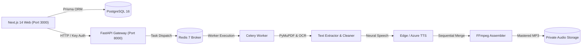

# AudioDoc SaaS - Commercial PDF to Neural Audio Platform

[](#)
[](#)
[](#)
[](#)
[](#)
[](#)
[](#)

**AudioDoc** is an enterprise-grade, distributed SaaS platform designed to convert complex digital and scanned PDF documents into high-fidelity neural MP3 audiobooks.

Built with a modern full-stack architecture combining **Next.js 14**, **Python FastAPI**, **Celery**, **Redis**, **PostgreSQL**, **PyMuPDF**, **Tesseract OCR**, and **FFmpeg**.

---

## Key Capabilities

- **Digital & Scanned PDF Ingestion**: PyMuPDF structural extraction with multi-column reading flow preservation and automated 300 DPI Tesseract OCR fallback.
- **Provider-Independent Neural TTS**: Native support for Microsoft Edge Neural Voices (zero credentials needed), Azure Speech Service, and deterministic offline mock providers.
- **Mastered MP3 Assembly**: Sequential chunk stitching, ID3 metadata tagging, and audio duration validation via FFmpeg.
- **Real-Time Pipeline Telemetry**: Step-by-step visual progress tracking (`QUEUED` -> `VALIDATING` -> `EXTRACTING` -> `OCR` -> `PREPROCESSING` -> `CHUNKING` -> `GENERATING_AUDIO` -> `MERGING` -> `COMPLETED`).
- **Rich In-Browser Player**: Native HTML5 audio player supporting HTTP 206 Partial Content range seeking, speed adjustment (0.5x–2.0x), and direct MP3 attachment downloading.
- **Tiered Commercial Subscriptions**: Flexible FREE, PRO, and BUSINESS subscription tiers with monthly quota enforcement and concurrent job limits.
- **Security & Multi-Tenancy**: OWASP ASVS compliance, PDF magic-byte checks (`%PDF-`), EOF validation, path traversal defense, and tenant row-level authorization.

---

## System Architecture



---

## Technology Stack

- **Frontend**: Next.js 14 (App Router), React 18, TypeScript (strict mode), Tailwind CSS, Lucide icons, Radix UI.
- **Backend API**: Next.js API Routes (Client Operations) + Python FastAPI (Document Gateway).
- **Background Workers**: Python Celery 5.7 backed by Redis 7.
- **Database & Persistence**: PostgreSQL 16 managed via Prisma ORM & SQLAlchemy 2 models.
- **Document & Audio Engines**: PyMuPDF (v2.1), Tesseract OCR, Pillow, Mutagen, FFmpeg 9.0+.
- **Testing**: Vitest & React Testing Library (Frontend), Pytest (Backend).
- **Containerization**: Docker & Docker Compose.

---

## Quickstart Guide

### 1. Prerequisites
- Node.js `>= 18.18` (Node 26+ verified) & `pnpm`
- Python `>= 3.10` (Python 3.14 verified)
- FFmpeg on system PATH (`ffmpeg` and `ffprobe`)
- PostgreSQL & Redis (or Docker)

### 2. Monorepo Installation
```bash
# Clone repository
git clone https://github.com/organization/pdf-to-audio.git
cd pdf-to-audio

# Install dependencies
pnpm install
pnpm approve-builds --all

# Build shared types package
pnpm --filter @pdf-to-audio/shared build

# Set up Python virtual environment
cd services/processor
python -m venv .venv
# Activate: .venv\Scripts\Activate.ps1 (Windows) or source .venv/bin/activate (Linux/Mac)
pip install -r requirements.txt
cd ../..
```

### 3. Environment Variables
Copy `.env.example` to `.env` and fill in secrets:
```bash
cp .env.example .env
```

### 4. Running Locally
In separate terminals:
```bash
# Terminal 1: Web Frontend
pnpm dev:web

# Terminal 2: FastAPI Processor
pnpm dev:processor

# Terminal 3: Celery Worker
pnpm dev:worker
```

### 5. Running with Docker Compose
```bash
docker compose up --build -d
```

---

## Automated Test Verification

### Backend Tests (Pytest) - 24/24 Passed
```bash
pytest services/processor/tests -v
```
- PDF binary safety, magic bytes, EOF markers, page limits: **PASSED**
- PyMuPDF text block and reading order extraction: **PASSED**
- Text cleaning, unicode normalization, hyphen repair: **PASSED**
- Sentence-aware and paragraph chunking: **PASSED**
- TTS Provider factory, Edge & Mock providers: **PASSED**
- FFmpeg audio merging and MP3 validation: **PASSED**
- FastAPI endpoints and health probes: **PASSED**

### Frontend Tests (Vitest) - 11/11 Passed
```bash
pnpm --filter web test
```
- UploadZone file signature check and size validation: **PASSED**
- VoiceSelector language filtering and speed adjustments: **PASSED**
- AudioPlayer controls, time formatting, seeking: **PASSED**
- ConversionProgressView pipeline tracking and states: **PASSED**
- Formatters and shared utilities: **PASSED**

### Next.js Production Build - 100% Successful
```bash
pnpm --filter web build
```
- All routes statically prerendered or flagged dynamic on demand without errors.

---

## Documentation Index

- [Architecture Overview](docs/ARCHITECTURE.md)
- [Installation Guide](docs/INSTALLATION.md)
- [API Specification](docs/API.md)
- [Database Architecture](docs/DATABASE.md)
- [Security & Compliance](docs/SECURITY.md)
- [Deployment Guide](docs/DEPLOYMENT.md)
- [Testing Suite Reference](docs/TESTING.md)
- [User Guide](docs/USER_GUIDE.md)
- [Troubleshooting & FAQ](docs/TROUBLESHOOTING.md)

---

## License

MIT License. Designed for commercial SaaS deployment and academic engineering evaluation.
