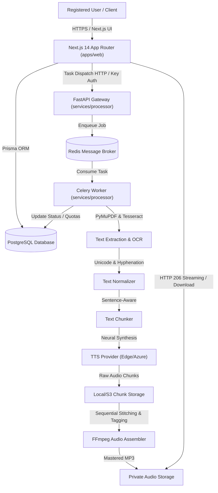
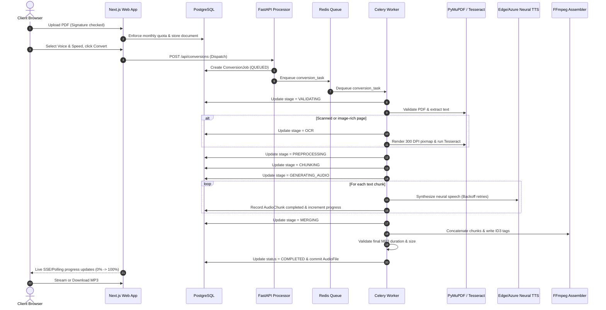

# Architecture Overview

## Commercial PDF-to-Audio Conversion SaaS Platform

The **AudioDoc** platform is an enterprise-ready, distributed SaaS solution engineered to convert complex digital and scanned PDF documents into studio-quality neural MP3 audiobooks.

---

## 1. System Components

### 1.1 Web Application (`apps/web`)
- **Framework**: Next.js 14 with App Router, React 18, TypeScript (strict mode).
- **Styling**: Tailwind CSS, Radix UI primitives, Lucide icons.
- **State & Forms**: React Hook Form with Zod validation schemas, TanStack Query.
- **Authentication**: NextAuth.js (Auth.js) credentials provider with bcrypt password hashing (12 rounds) and JWT sessions.
- **Database Access**: Prisma ORM with connection pooling, transactional updates, and UUID primary keys.

### 1.2 Processor Service (`services/processor`)
- **API Layer**: FastAPI asynchronous microservice with OpenAPI v3 schema and internal API key authentication (`X-Internal-Secret`).
- **Worker Execution**: Celery 5.7 distributed worker cluster backed by Redis.
- **Text Extraction**:
  - `PyMuPDF` (Fitz 2.1+) for structural page-by-page block extraction, multi-column reading order preservation, and font metadata analysis.
  - `Tesseract OCR` adaptive fallback rendering scanned pages at 300 DPI via `Pillow` and `pytesseract`.
- **Text Normalization**: Unicode NFKC normalization, hyphenation repair across soft/hard linebreaks, and header/footer artifact suppression.
- **Sentence-Aware Chunking**: Punctuation- and clause-bounded chunking respecting maximum character budgets without splitting words.
- **Audio Processing**:
  - Abstract `TTSProvider` interface supporting Edge Neural TTS, Azure Speech Service, and deterministic Mock TTS.
  - `FFmpeg 9.0+` sequential MP3 demuxing, bitrate normalization, ID3 tagging, and ffprobe validation.

### 1.3 Persistence & Infrastructure
- **PostgreSQL 16**: Relational storage for users, accounts, subscriptions, documents, conversion jobs, chunks, and audit logs.
- **Redis 7**: Distributed queue, job lock manager, and worker heartbeat coordination.
- **Private Object Storage**: Segmented directories (`storage/uploads`, `storage/chunks`, `storage/audio`) isolated from public web access.

---

## 2. End-to-End Pipeline Sequence

---

## 3. Security Boundary & Ownership Isolation
- **Authentication**: All Next.js and processor routes enforce session tokens.
- **Authorization**: Row-level tenant isolation ensures users can only access their own documents, jobs, and audio streams.
- **File Validation**: MIME types are ignored; binary magic bytes (`%PDF-`) and EOF markers are strictly verified.
- **Path Traversal Guard**: Filenames are cryptographically randomized using UUIDv4; paths outside resolved storage directories are rejected with 403 Forbidden.
- **Internal Service Protection**: FastAPI processing endpoints require a shared secret header (`X-Internal-Secret`) matching `INTERNAL_SERVICE_SECRET`.

