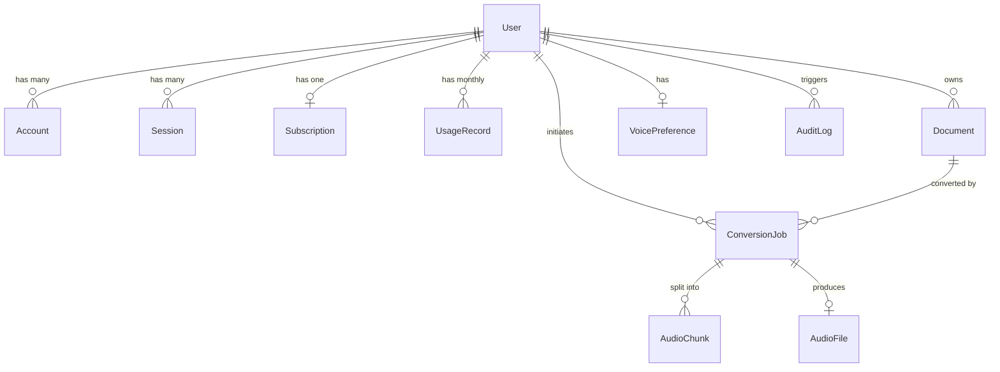

# Database Architecture & Schema Specification

The **AudioDoc** platform uses **PostgreSQL 16** with UUID primary keys and strict relational integrity. Both **Prisma ORM** (Next.js) and **SQLAlchemy 2** (Python Processor) share the exact identical schema definition to avoid competing schemas.

---

## 1. Entity-Relationship Diagram



---

## 2. Table Specifications

### 2.1 `users`
Core user identity and role assignment.
- `id` (UUID, PK, default uuid_generate_v4())
- `email` (VARCHAR(255), UNIQUE, NOT NULL)
- `name` (VARCHAR(255))
- `password_hash` (VARCHAR(255))
- `role` (VARCHAR(32), NOT NULL, default 'USER') - `USER` or `ADMIN`
- `subscription_tier` (VARCHAR(32), NOT NULL, default 'FREE') - `FREE`, `PRO`, `BUSINESS`
- `created_at` (TIMESTAMPTZ, default now())
- `updated_at` (TIMESTAMPTZ)

### 2.2 `subscriptions`
Active plan tier and billing cycle state.
- `id` (UUID, PK)
- `user_id` (UUID, UNIQUE, FK -> users.id ON DELETE CASCADE)
- `tier` (VARCHAR(32), default 'FREE')
- `status` (VARCHAR(32), default 'ACTIVE') - `ACTIVE`, `PAST_DUE`, `CANCELED`
- `current_period_start` (TIMESTAMPTZ)
- `current_period_end` (TIMESTAMPTZ)

### 2.3 `usage_records`
Monthly usage tracking and quota enforcement.
- `id` (UUID, PK)
- `user_id` (UUID, FK -> users.id ON DELETE CASCADE)
- `billing_cycle` (VARCHAR(7), NOT NULL) - e.g. `'2026-11'`
- `conversions_count` (INTEGER, default 0)
- `characters_count` (INTEGER, default 0)
- `pages_count` (INTEGER, default 0)
- Unique constraint: `(user_id, billing_cycle)`

### 2.4 `documents`
Uploaded PDF documents and binary safety metadata.
- `id` (UUID, PK)
- `user_id` (UUID, FK -> users.id ON DELETE CASCADE)
- `filename` (VARCHAR(255), NOT NULL) - Server-side random UUID filename
- `original_filename` (VARCHAR(255), NOT NULL) - User-provided name
- `file_size` (BIGINT, NOT NULL)
- `page_count` (INTEGER, NOT NULL)
- `mime_type` (VARCHAR(128), default 'application/pdf')
- `sha256_hash` (VARCHAR(64), NOT NULL)
- `storage_path` (VARCHAR(512), NOT NULL)

### 2.5 `conversion_jobs`
State machine tracking end-to-end conversion.
- `id` (UUID, PK)
- `user_id` (UUID, FK -> users.id ON DELETE CASCADE)
- `document_id` (UUID, FK -> documents.id ON DELETE CASCADE)
- `status` (VARCHAR(32), default 'QUEUED')
  - `QUEUED`, `VALIDATING`, `EXTRACTING`, `OCR`, `PREPROCESSING`, `CHUNKING`, `GENERATING_AUDIO`, `MERGING`, `COMPLETED`, `FAILED`, `CANCELLED`
- `progress_percent` (INTEGER, default 0)
- `stage_message` (VARCHAR(255))
- `error_message` (TEXT)
- `voice_id` (VARCHAR(128), NOT NULL)
- `voice_name` (VARCHAR(128), NOT NULL)
- `language` (VARCHAR(32), default 'en-US')
- `speed` (FLOAT, default 1.0)
- `retry_count` (INTEGER, default 0)
- `max_retries` (INTEGER, default 3)

### 2.6 `audio_chunks`
Granular text chunk status for speech synthesis and parallel processing.
- `id` (UUID, PK)
- `conversion_job_id` (UUID, FK -> conversion_jobs.id ON DELETE CASCADE)
- `chunk_index` (INTEGER, NOT NULL)
- `text_content` (TEXT, NOT NULL)
- `character_count` (INTEGER, NOT NULL)
- `storage_path` (VARCHAR(512))
- `status` (VARCHAR(32), default 'PENDING')
- `retry_count` (INTEGER, default 0)

### 2.7 `audio_files`
Mastered, validated MP3 output references.
- `id` (UUID, PK)
- `conversion_job_id` (UUID, UNIQUE, FK -> conversion_jobs.id ON DELETE CASCADE)
- `user_id` (UUID, FK -> users.id ON DELETE CASCADE)
- `storage_path` (VARCHAR(512), NOT NULL)
- `file_size_bytes` (BIGINT, NOT NULL)
- `duration_seconds` (INTEGER, NOT NULL)
- `bitrate_kbps` (INTEGER, default 48)
- `sample_rate_hz` (INTEGER, default 24000)

---

## 3. Migration & Synchronization Strategy

- **Next.js Engine**: Uses Prisma schema (`infrastructure/database/schema.prisma` and `apps/web/prisma/schema.prisma`).
- **Python Processor**: Uses SQLAlchemy models (`services/processor/app/database/models.py`) with identical column definitions, constraints, and cascade behaviors.
- **Migration Execution**:
  ```bash
  # Push schema directly
  pnpm --filter web db:push
  ```

