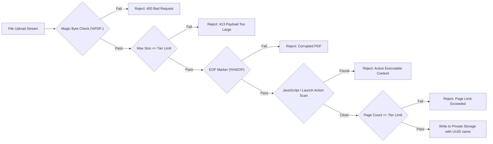

# Application Security & Compliance Architecture

The **AudioDoc** platform is engineered adhering strictly to the **OWASP Application Security Verification Standard (ASVS)**, ensuring tenant data privacy, memory safety, path traversal protection, and defense-in-depth against malicious payloads.

---

## 1. Authentication & Session Security

- **Credential Hashing**: Passwords are encrypted using `bcrypt` with a cost work factor of 12 rounds. Plaintext passwords are never logged, persisted, or returned in API responses.
- **Session Strategy**: Stateless, tamper-proof JSON Web Tokens (JWT) signed with a minimum 256-bit cryptographically secure secret (`NEXTAUTH_SECRET`).
- **Session Expiry**: Configured to 30 days max age, with automatic token revocation on logout.
- **CSRF & SameSite**: NextAuth automatically embeds Anti-CSRF double-submit cookies on state-modifying requests (`POST`, `DELETE`, `PATCH`).

---

## 2. Authorization & Tenant Isolation (RBAC)

- **Role Levels**:
  - `USER`: Regular authenticated customer. Can only view, create, delete, and download their own documents and audio conversions.
  - `ADMIN`: Platform operator. Can view system health, telemetry, global user directory, conversion queues, and audit logs.
- **Row-Level Enforcement**: Every database query filters by `userId: session.user.id`. Client-provided `userId` parameters are strictly ignored and overwritten with the authenticated session context.

---

## 3. PDF Upload & Ingestion Hardening

To prevent Remote Code Execution (RCE), Denial of Service (DoS), or Zip/Decompression bombs:

1. **Binary Signature Verification**:
   - Every file must start with the 5 magic bytes `%PDF-` (`0x25, 0x50, 0x44, 0x46, 0x2D`). Files disguised with `.pdf` extension but containing alternate binaries are rejected immediately.
2. **EOF Marker Check**:
   - The file trailing bytes are checked for standard PDF termination markers (`%%EOF`).
3. **Active Executable Screening**:
   - The document catalog is parsed for suspicious launch keys, embedded `/JavaScript`, and active automated triggers.
4. **Encrypted PDF Rejection**:
   - Password-protected or encrypted PDFs that cannot be reliably converted are safely rejected with descriptive feedback.

---

## 4. File Storage & Path Traversal Prevention

- **Randomized Server Filenames**: Uploaded documents and synthesized audio files are renamed using `uuid.uuid4()`. Original client filenames are stored in PostgreSQL metadata only.
- **Storage Isolation**: Files are stored outside public web roots (`storage/uploads`, `storage/chunks`, `storage/audio`). Direct static file serving is completely disabled.
- **Path Resolution Checks**: The `StorageManager` normalizes and canonicalizes all paths via `os.path.realpath`. Any path attempting directory traversal (e.g., `../../etc/passwd` or `..\..\Windows`) triggers a `SecurityException` and returns HTTP 403 Forbidden.

---

## 5. Microservice Protection & Internal API Keys

- Direct network access between Next.js and the FastAPI processor is secured via the `X-Internal-Secret` HTTP header matching `INTERNAL_SERVICE_SECRET`.
- External requests without the secret or with invalid secrets are rejected with HTTP 401 Unauthorized.

---

## 6. Audio Streaming Protection

- The `/api/audio/[id]` endpoint verifies session ownership before opening the audio file descriptor.
- HTTP 206 Partial Content range requests are validated to prevent integer overflow or out-of-bounds byte reads.
