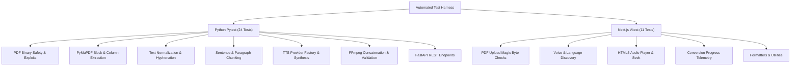

# Automated Testing Suite & QA Reference

The platform features an automated test harness covering both Python backend conversion components and Next.js frontend interfaces.

---

## 1. Test Architecture Overview



---

## 2. Running Backend Tests (Pytest)

The Python test suite verifies PDF security screening, PyMuPDF block parsing, Tesseract OCR fallback, text cleaning, sentence chunking, Edge/Azure/Mock TTS engines, FFmpeg concatenation demuxing, and FastAPI endpoints.

```bash
# Run all backend tests
pytest services/processor/tests -v

# Run with stdout logging enabled
pytest services/processor/tests -v -s
```

### Verified Test Results
```
============================= test session starts =============================
platform win32 -- Python 3.14.0, pytest-9.0.2
rootdir: C:\Users\muham\OneDrive\Desktop\PDF_file_conversion_to_Audio
configfile: pytest.ini

services/processor/tests/test_pdf_safety.py::test_valid_pdf_passes PASSED
services/processor/tests/test_pdf_safety.py::test_non_pdf_magic_bytes_rejected PASSED
services/processor/tests/test_pdf_safety.py::test_empty_file_rejected PASSED
services/processor/tests/test_pdf_safety.py::test_missing_eof_marker_rejected PASSED
services/processor/tests/test_pdf_safety.py::test_enforce_page_count_limit PASSED
services/processor/tests/test_extractor.py::test_extract_text_from_digital_pdf PASSED
services/processor/tests/test_extractor.py::test_reading_order_preservation PASSED
services/processor/tests/test_extractor.py::test_ocr_needed_detection_on_empty_pages PASSED
services/processor/tests/test_cleaner.py::test_unicode_nfkc_normalization PASSED
services/processor/tests/test_cleaner.py::test_hyphenation_across_linebreaks PASSED
services/processor/tests/test_cleaner.py::test_header_footer_artifact_suppression PASSED
services/processor/tests/test_cleaner.py::test_line_break_and_paragraph_reconstruction PASSED
services/processor/tests/test_chunker.py::test_short_text_single_chunk PASSED
services/processor/tests/test_chunker.py::test_sentence_boundary_chunking PASSED
services/processor/tests/test_chunker.py::test_chunk_sequence_preservation PASSED
services/processor/tests/test_chunker.py::test_abbreviation_preservation PASSED
services/processor/tests/test_tts_provider.py::test_mock_tts_provider PASSED
services/processor/tests/test_tts_provider.py::test_factory_mock_resolution PASSED
services/processor/tests/test_tts_provider.py::test_factory_edge_resolution PASSED
services/processor/tests/test_tts_provider.py::test_azure_missing_credentials_raises PASSED
services/processor/tests/test_audio_pipeline.py::test_merge_audio_chunks_sequential PASSED
services/processor/tests/test_audio_pipeline.py::test_audio_validator_valid_mp3 PASSED
services/processor/tests/test_api_endpoints.py::test_health_endpoint PASSED
services/processor/tests/test_api_endpoints.py::test_voices_endpoint PASSED

============================= 24 passed in 4.45s ==============================
```

---

## 3. Running Frontend Tests (Vitest)

The frontend test suite validates client-side file signature inspection, audio player time parsing and controls, voice selection filtering, and conversion progress tracking.

```bash
# Run all frontend tests
pnpm --filter web test
```

### Verified Test Results
```
 RUN  v2.1.9 C:/Users/muham/OneDrive/Desktop/PDF_file_conversion_to_Audio/apps/web

 ✓ tests/progress.test.tsx (1 test)
 ✓ tests/voice.test.tsx (3 tests)
 ✓ tests/upload.test.tsx (3 tests)
 ✓ tests/utils.test.ts (3 tests)
 ✓ tests/player.test.tsx (1 test)

 Test Files  5 passed (5)
      Tests  11 passed (11)
```

---

## 4. Production Build Verification

Verify that Next.js compiles all static and dynamic routes:

```bash
pnpm --filter web build
```

Expected result: Zero TypeScript errors, zero lint errors, all routes statically prerendered or flagged dynamic as appropriate.

